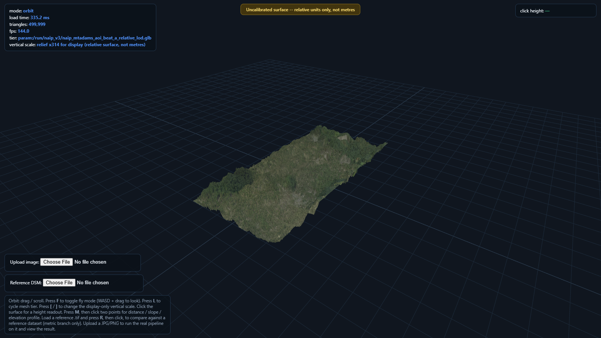
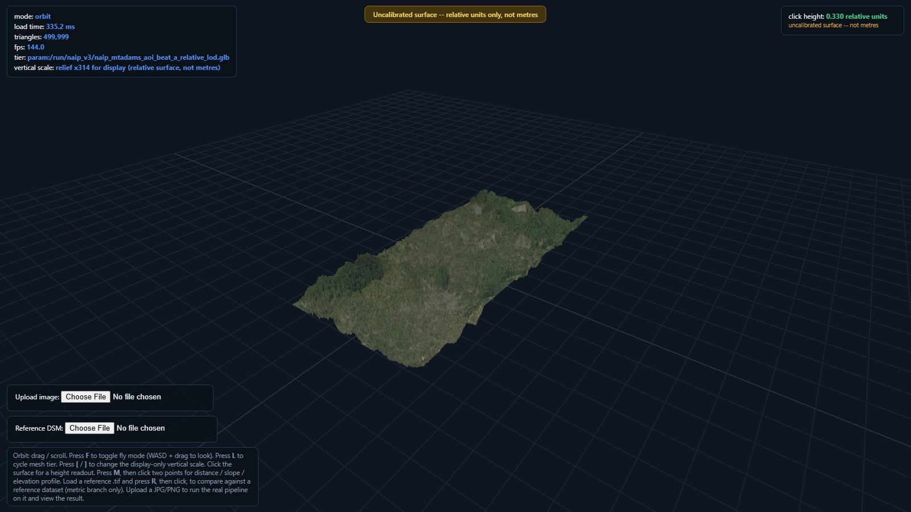

# DepthWizard: single-image terrain height and a navigable 3D viewer (SIH 2026, SIH26175)

DepthWizard turns **one overhead RGB image** into a height surface and loads it in an offline three.js viewer that you can orbit, fly through and measure on.

This is the submission snapshot of our development repository (fresh history, curated contents). The full development record stays private.

## What it does

```
overhead RGB -> Depth Anything V2 Small (fine-tuned) -> tiled, feather-blended relative depth
             -> relative surface (always) -> mesh + LOD tier -> local three.js viewer
             -> metric DSM (GeoTIFF + mesh) ONLY when the gates below pass
```

Stages in `run_pipeline.py`: `validate -> tile -> predict -> blend -> calibrate`, then `to_mesh / to_lod / to_geotiff`.

**Relative vs metric output (kept strictly apart)**

- The **relative** surface is always produced. It is unitless and uncalibrated: no metres, no datum, no RMSE may be attached to it. The viewer labels it that way.
- A **metric** DSM is written only when the input is genuinely georeferenced, vertical reference points are supplied, and the pre-flight gate accepts them. Otherwise the run stays relative and records why. The metric scale and shift are fitted to the reference points with RANSAC first; only if the RANSAC fit raises an exception does the runner fall back to ordinary least squares, and it records `ols_fallback` and the exception type in the run manifest. A fit that is not finite or has a non-positive scale is rejected.
- The pre-flight gate checks: at least 10 reference points, at least 15 % hull coverage of the image, a median nearest-neighbour spread (normalised by the expected spacing for uniformly spread points) of at least 0.25, and reference relief (max minus min of the supplied reference elevations) of at most 87.5 m. **These thresholds are provisional engineering floors, not validated cutoffs; the relief threshold is derived from one known-failure scene.** The relief statistic is computed from the sparse supplied points only, so a low value is not proof that the scene is safe. A gate pass is an eligibility check, not an accuracy guarantee.

## Model identity

| | |
|---|---|
| Runner default | **v3**: `da2_small_finetuned_v3_full_encoder_ema.pt`, SHA-256 `a1e3fca34874856196e53fe9be2be1ee10d1b038c741157dfd6472f74e299ea7` |
| Recipe | Depth Anything V2 Small, all 12 encoder blocks adapted, released weights are an exponential moving average (decay 0.995) of the run |
| Selection evidence | Frozen, pre-registered **train-only** screens on held-out Vaihingen training areas. The released file was then trained once on all 21 training areas, so **the file itself has no held-out evaluation.** v3 was **never evaluated on the dev or historical-test partitions.** |
| Rollback (B0) | `da2_small_finetuned_iter2_partial_unfreeze.pt`, SHA-256 `74ccde40cf703095ed2adb783394d0dd2692b3ffaaf3b8a9e534e27feeba78d8`; opt-in via `DW_CHECKPOINT` and `DW_CHECKPOINT_SHA256` |

What the evidence supports: in the train-only screens, the v3 **recipe** (EMA weights of the all-12-block run) had lower *reference-aligned relative-shape RMSE* (per-patch least-squares scale and shift) than the earlier v2 recipe, and the v2 recipe lower than B0. That metric measures surface shape; **it is not DSM accuracy and not deployable metric RMSE.** No NAIP, Sentinel-2, mountain, satellite-transfer or metric-DSM improvement is claimed for v3. Details: `10_DOCUMENTATION/evidence/DW_MODEL_V3_FULL_ENCODER_EMA/README.md` (the raw screen results are kept in the private development record and are not in this snapshot, so those numbers cannot be re-derived from this repository). Earlier dev/test numbers in `DW_MODEL_V2_FULL_ENCODER/` describe the **v2 recipe**, not v3.

## Measured results, and where it fails

Every accuracy figure below is the frozen **B0 baseline**, not a v3 result. One row per terrain, not an aggregate.

| Terrain (scene) | RMSE | Calibration | Read it as |
|---|---|---|---|
| Urban/flat (ISPRS Vaihingen) | **5.50 m** | 10 sparse reference points | Best result in this one benchmark setting, scored against an image-matching DSM. The 4.40 m full-oracle figure is a non-deployable upper bound. |
| Hilly (Mount Adams) | **60.2-61.9 m** full-scene oracle; **67.7-69.6 m** with 10 sparse points | one scale and shift per scene | **Fails.** Cause not isolated. A regional-calibration retest also failed, and a constrained-refit attempt did not pass its stopping rule. The relief gate declines the metric branch above 87.5 m of reference relief (provisional, in-sample threshold). |
| Sparse/desert (Mojave, Sentinel-2 + USGS 3DEP) | **39.0 m** oracle; **39.4-41.0 m** for 10-200 points; 70.1 m at 1 point and 88.7 m at 5 points (sign-inverted fit) | oracle and sparse | **Fails.** One scene only. |

- Forest and India-domain terrain have no metric DSM validation. Forest checks were per-patch oracle agreement with a model-derived canopy-height reference in one Pacific Northwest scene family: canopy height, not DSM, not deployable accuracy. Percentage reductions quoted in the `PHASE2_RED_FLAGS/` forest documents are oracle-versus-proxy figures of that kind.
- The Mojave row is the only satellite-imagery accuracy result, and it is one scene.
- Reference point placement matters more than count: at N=10, clustered points measured 15.32 m mean / 28.42 m worst against 4.70 m for stratified ones.
- Nothing here is calibrated uncertainty.
- The Vaihingen reference (`dsm_09cm_matching`) is a dense image-matching DSM, not LiDAR ground truth.

Evidence index: `FINAL_CLAIM_EVIDENCE_MATRIX.md`, `FINAL_EVIDENCE_INDEX.md`, `11_EVIDENCE_AND_CLAIMS/FINAL_METRIC_TRUTH_TABLE.md`, `BASELINE_v1.0.md`, `PHASE2_RED_FLAGS/` (stress-test reports), `10_DOCUMENTATION/evidence/` (Mojave, hilly gate, hilly confirmatory and gate-validation runs). Some of these files mention supporting documents that stay in the private development record.

## Product screenshots

Real output of the v3 default checkpoint on a USDA NAIP aerial image of the Mount Adams area (4000 x 2200 px, from the NAIP Washington 2023 program), relative branch, 499,999-triangle LOD tier, loaded in the offline viewer. The viewer labels the surface "Uncalibrated surface -- relative units only, not metres" and shows the height readout in relative units.




One recorded run on the development laptop (33 s end to end); its run manifest, which records the v3 checkpoint hash, is kept in the private record and is not in this snapshot. These screenshots illustrate the product; they are not accuracy evidence. Image sources and terms: see "Image provenance" below.

## What you can run, and what needs a checkpoint

**The checkpoint is not in this repository.** It is intentionally not in Git and there is no public download route. Inference (`run_pipeline.py`, or an upload in the viewer) therefore needs the v3 file supplied separately, plus the Depth Anything V2 Small backbone already present in the local Hugging Face cache. The runner does not silently download the backbone when a fine-tuned checkpoint is used, and the snapshot we used is recorded in `REPRODUCIBILITY.md`. The runner checks the SHA-256 before loading and refuses a mismatch. A fresh clone alone does **not** produce a model prediction.

**How an authorized evaluator can obtain the checkpoint:** request it from the team (open an issue on this repository or contact the repository owner, @anmol-228, through GitHub or the SIH submission contact). It is supplied privately together with its SHA-256; verify the hash before use. The public repository never contains the weights.

What a fresh clone supports without a checkpoint:

```bash
pip install -r requirements-dev.txt     # requirements.txt plus pytest; torch cu129 wheel index required for the pinned build
python -m pytest -q                     # 183 tests were reported passing on the team's development environment
node tests/viewer/test_sidecar.mjs      # 16 viewer tests (needs Node.js)

# Viewer with the bundled synthetic placeholder mesh (offline)
pip install -r viewer/requirements.txt
python viewer/server.py                 # then open http://localhost:8793/
```

The viewer server also exits at startup, with an explanatory message, unless the Depth Anything V2 Small snapshot is already in the local Hugging Face cache, even when you only want the placeholder mesh. The 183/16 test runs above do not need the cache.

Limits of that test claim: the 183/16 results were obtained from a fresh clone of this snapshot using an already-provisioned Python environment, not from a clean-machine installation, and without a checkpoint. Python 3.12 or 3.14 is expected; the pins target Python 3.12+.

With a checkpoint in `checkpoints/`:

```bash
python run_pipeline.py <image.png|geotiff> --out outputs/run/<scene>
python run_pipeline.py <geotiff> --reference <control_points.npy> --out outputs/run/<scene>   # metric branch, if the gates pass
python viewer/server.py                 # load outputs via the upload widget, or ?glb=/run/<scene>/<scene>_relative_lod.glb
```

Viewer controls: `F` fly mode, `L` cycle mesh tier, `[` `]` display-only vertical scale, click for height readout, `M` two-point distance/height/slope/profile. `viewer/README.md` has the details.

## Known limitations of the code (found in a final independent automated (AI) read-through, not fixed for this release)

- **Georeferencing support is narrow.** The GeoTIFF reader uses ProjectedCSType keys, ModelPixelScale/Tiepoint tags or a `.tfw`, and assumes a north-up grid. Geographic-CRS or rotated inputs are not reliably detected, and the metric writer labels its output as projected metres. Use projected, north-up inputs only.
- **Reuse a fresh `--out` directory for every run.** The output directory is not cleaned, so a metric file from an earlier run with the same scene name can still be listed by the viewer next to a new relative-only run.
- **Nodata handling is incomplete.** The training and evaluation patches (`scripts/04_make_patches.py`, `06_finetune.py`, `07_calibrate_and_eval.py`) allow a small fraction of invalid pixels without masking them, and the viewer's reference-DSM comparison does not reject nodata values. Reported Vaihingen RMSE figures were produced with that pipeline and were not re-scored with nodata excluded.
- **`--depth-sign -1`** flips only the relative output; it is not applied before metric calibration.
- **Viewer sidecar validation** does not check that a relative sidecar carries only a pseudo pixel size and a metric sidecar a real one.
- `scripts/06_finetune.py` writes to a `logs/` directory (a placeholder is included).

## Repository map

- `run_pipeline.py`, `src/`: pipeline, tiling and blending, calibration, pre-flight gate, GeoTIFF and mesh export.
- `viewer/`: offline three.js viewer and its local server (three.js is vendored, no CDN).
- `tests/`, `scripts/`, `configs/`, `fixtures/`: tests, the numbered experiment scripts, fine-tune configs, interface fixtures.
- `ARTIFACT_MANIFEST.md`, `REPRODUCIBILITY.md`, `DATA_SOURCES.md`: checkpoint hashes, reproducibility limits, data provenance.

## Not included on purpose

Raw datasets, checkpoints, model weights, the demo video and the team's internal working material. Papers and datasets are linked in `DATA_SOURCES.md` rather than copied. Imagery derived from the ISPRS Vaihingen benchmark is not redistributed here.

## Team

Anmol, Nirmalya, Ashmita, Aishee, Adrija, Debopriya.

## Image provenance

| Image | What it shows | Source |
|---|---|---|
| `docs/screenshots/viewer_naip_v3_relative_lod.png`, `docs/screenshots/viewer_naip_v3_height_readout.png` | Viewer screenshots of the v3 relative surface, textured with NAIP RGB of the Mount Adams (WA) area | USDA Farm Service Agency NAIP, Washington 2023 program, tile 4512103_sw, obtained through Microsoft Planetary Computer, cropped and rendered without colour adjustment |
| `PHASE2_RED_FLAGS/outputs/figures/E_alignment_check.png` | NAIP RGB, USGS 3DEP 1 m DEM and a contour overlay of the same Mount Adams area | USDA NAIP; USGS 3D Elevation Program |
| `PHASE2_RED_FLAGS/outputs/figures/E_slope_vs_rmse.png` | A chart of RMSE by slope bin (no imagery) | Derived from the Mount Adams hilly test (B0-era evidence) |

No Vaihingen-derived imagery is included.

## Attribution

- **ISPRS Vaihingen benchmark**: used for training and evaluation only, under its academic/research-use terms. Not redistributed; no Vaihingen imagery in this repository.
- **Sentinel-2 L2A**: Contains modified Copernicus Sentinel data 2021.
- **Copernicus DEM GLO-30**: Produced using Copernicus WorldDEM-30 (c) DLR e.V. 2010-2014 and (c) Airbus Defence and Space GmbH 2014-2018 provided under COPERNICUS by the European Union and ESA; all rights reserved. The organisations in charge of the Copernicus programme by law or by delegation do not incur any liability for any use of the Copernicus WorldDEM-30.
- **ETH Global Canopy Height 2020**: Lang, N., Jetz, W., Schindler, K., & Wegner, J. D. (2023). A high-resolution canopy height model of the Earth. Nature Ecology & Evolution. CC BY 4.0. Used as a proxy reference, not ground-survey truth.
- **USDA NAIP** (imagery): "U. S. Department of Agriculture, Farm Service Agency" (the attribution wording the FSA policy page suggests). FSA states that most FSA information is public domain and may be freely distributed with attribution; the NAIP catalogue record on Microsoft Planetary Computer designates NAIP "Public Domain" by pointing to that policy, and the USGS EROS NAIP product page lists its usage as public domain.
- **USGS 3DEP** (elevation): USGS states that USGS-authored or produced data and information are in the U.S. public domain; credit "U.S. Geological Survey".
- **Depth Anything V2 Small**: base backbone, Apache-2.0.

## Rights

This repository is publicly viewable for evaluation. No open-source licence is granted; all rights are reserved by the authors unless stated otherwise. Third-party data and models keep their own terms.
